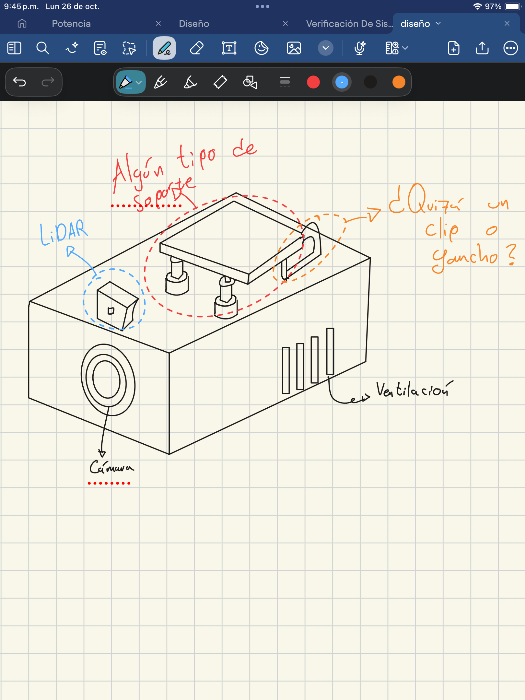
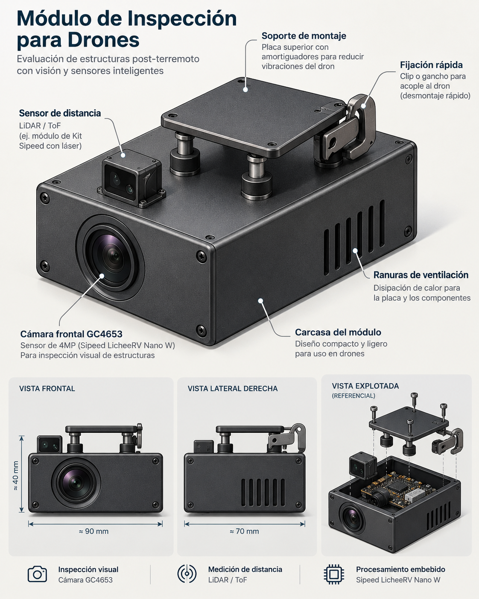

# Módulo de inspección estructural post-sismo

**Proyecto individual de Diseño Electrónico — entrega de diseño CAD + juego AR/VR.**

Propuesta conceptual de un **módulo electrónico acoplable a un dron comercial existente** para apoyar la inspección visual de estructuras después de un sismo. **Este proyecto no consiste en diseñar ni fabricar el dron**: el dron es la plataforma portadora.

## Evidencias de diseño

| Boceto original | Rediseño conceptual |
|:---:|:---:|
|  |  |

## Funciones propuestas

- Captura de imágenes de elementos estructurales mediante la cámara **GC4653**.
- Análisis visual exploratorio de posibles grietas, sujeto a desarrollo y validación.
- Estimación de distancia/dimensiones **solo si se añade y calibra un método de medición adecuado**.
- Registro o transmisión de evidencias para revisión por el operador.

Las alertas de riesgo que eventualmente muestre la simulación son **datos demostrativos, no diagnósticos estructurales**. No se incluye sensor de gases.

## Plataforma propuesta

- Procesamiento: **Sipeed LicheeRV Nano W** (kit adquirido).
- Cámara: **Sipeed GC4653** (kit adquirido).
- Carcasa desmontable con ventana óptica, ventilación y sistema de acople al dron.
- LiDAR/ToF y elementos de sujeción dibujados: **propuestas conceptuales pendientes de selección y validación**.
- Dimensiones de carcasa en el render: **orientativas; no son medidas fabricables ni definitivas**.

## Organización

```text
assets/
  referencias/
    01-boceto-original.png
    02-render-profesional.png
  modelos-3d/
    (modelo .glb/.obj pendiente)
docs/
  alcance.md
  entrega.md
  prompt-arena.md
README.md
.gitignore
```

La aplicación interactiva se añadirá después en la **raíz del repositorio** (`index.html` o proyecto web con su configuración), para facilitar el despliegue con GitHub Pages.

## Estado actual

- [x] Boceto original.
- [x] Rediseño conceptual asistido por IA.
- [ ] Modelo 3D generado (.glb / .obj).
- [ ] Modelo verificado en 3D Viewer.
- [ ] Juego web interactivo de inspección post-sismo.
- [ ] Despliegue público y prueba en GitHub Pages.

Consulta [docs/entrega.md](docs/entrega.md) para completar y entregar el trabajo.
